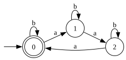

# Automatix



Automatix est une bibliothèque Python pédagogique qui étend
**automata-lib 9.2.0** : automates déterministes et non déterministes,
expressions régulières, grammaires régulières et opérations sur les langages.
Les transformations créent de nouveaux objets sans modifier l'automate source.

## Trouver la bonne documentation

| Vous voulez… | À consulter |
| --- | --- |
| Trouver une méthode, sa portée et ses tests | [API et suivi des fonctionnalités](IMPLEMENTATION_STATUS.md) |
| Énumérer ou compter les exécutions acceptantes d'un NFA | [Guide de l'exercice 38](ACCEPTING_RUNS.md) |
| Construire un DFA par dérivées de regex | [Guide de l'exercice 51](DERIVATIVE_DFA.md) |
| Comprendre les choix et limites de l'architecture | [Décisions d'architecture](decisions/README.md) |
| Voir les compléments du TD restant à réaliser | [Travaux à venir](TD_BACKLOG.md) |
| Modifier ou construire ce site | [Contribuer à la documentation](DOCUMENTATION.md) |

Les guides, le suivi et les décisions affichés ici sont les fichiers Markdown
du dépôt. Certains documents historiques restent en anglais. La recherche
indexe les deux langues et toutes les décisions d'architecture.

## Installer la bibliothèque

Python **3.11 ou plus** est nécessaire. Depuis une copie du dépôt :

```bash
python -m pip install -e .
```

Les rendus SVG, PNG et PDF demandent aussi l'exécutable **Graphviz `dot`**
dans le `PATH`. L'export vidéo demande **FFmpeg**. Ces outils ne sont pas
nécessaires pour lire ou construire ce site documentaire.

## Un premier automate

```python
from automata_extensions.fa import ExtendedDFA

dfa = ExtendedDFA(
    states={"q0", "q1"},
    input_symbols={"a"},
    transitions={"q0": {"a": "q1"}, "q1": {"a": "q1"}},
    initial_state="q0",
    final_states={"q1"},
)

assert dfa.accepts("aaa")
assert not dfa.accepts("")
assert dfa.trim().minimize().is_equivalent(dfa)
```

Cet automate reconnaît les mots contenant au moins un `a` sur l'alphabet
`{"a"}`. Le [README du dépôt](https://github.com/Optimusp-prime/Automatix#readme)
propose aussi vingt démonstrations : parcours, opérations sur les langages,
déterminisation, grammaires, équations, monoïdes et exports.


